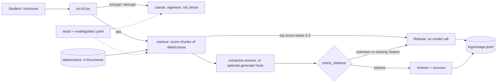

# Design Review · Vein

Members: <name, role> · Repo: https://github.com/nikagoci/Vein · Graded commit: tag `design-review`

Status legend: **built** = code, tests and evidence exist in the repo. **planned** = not built, and not claimed as working.

## 1 · Problem, users, success criteria

**Problem.** Students learning classical cryptography get worked examples from scattered, untested scripts, and instructors have no small reference they know is correct. Vein is a tested reference implementation of three classical ciphers, with a grounded question-answering layer that explains them from our own documents, cites them, and refuses when it cannot.

**Users.** First-year security students needing worked examples; instructors wanting a correct reference; developers verifying a cipher before trusting a library. Spec: `docs/spec.md`.

| # | Success criterion | Measured by | Status |
|---|---|---|---|
| AC1 | `pytest` is green: known-answer and round-trip tests for Caesar, Vigenère, Rail Fence | `tests/test_ciphers.py` | built, 30 tests passing across `tests/` |
| AC2 | Invalid keys raise `ValueError`, never silent garbage | `tests/test_ciphers.py` (bad Rail Fence keys, non-integer Caesar shift, empty Vigenère key) | built. A *wrong* key cannot be detected by these ciphers; stated in `data/corpus/limits.md` |
| AC3 | Grounded answers cite a retrieved source or refuse | `tests/test_answer.py`, `evals/golden.yaml` | built (extractive answers, no model call yet) |
| AC4 | Every answer or refusal writes one line to `logs/usage.jsonl` | `logs/usage.jsonl` | built. Lines record the question, outcome, reason, top score and model (`none`); token counts apply once a model is plugged in |

Scope: three ciphers only (`docs/decisions/0001-cipher-scope.md`). No claim of real cryptographic security; no AES/RSA.

## 2 · Architecture and data flow

| Component | Input | Output | Validated by |
|---|---|---|---|
| Cipher modules | text, key | text | key checks (`ValueError`), pytest |
| `retrieve.py` | question, corpus paragraphs | chunks with a score in [0, 1] (idf-weighted share of the question's words found in the chunk) | tests, golden set |
| `answer.py` | question | `{answer, citations, grounded, reason}` | `check_citations()`: every sentence must cite a retrieved `[n]`; failure is a refusal, never a warning |
| Model hook | question, hits | answer text | same `check_citations()`. **Planned:** no real model is connected; the default path calls none |

The cheapest safety feature is the refusal before generation: if nothing scores above the threshold, nothing is produced.

## 3 · Risks and safety threats

| Risk | What a user would see | Mitigation | Status |
|---|---|---|---|
| Wrong key returns plausible garbage | A student trusts a bad decryption | Unavoidable for these ciphers; AC2 covers invalid keys only; documented in the corpus and README | documented |
| Users treat these ciphers as secure | Real secrets "protected" by Caesar | "Not secure, for learning" stated in spec, corpus (`limits.md`) and README | built |
| An invented citation or uncited claim | A fact with no real source | `check_citations()` refuses unknown, missing or uncited sentences; 3 offline tests | built |
| A real citation on a wrong sentence | Correct source, misleading text | Answers are extracted verbatim from sources today; `must_mention` in the golden set. LLM judge not built | partial |
| Keyword retrieval misses synonyms or over-matches | A valid question refused, or a loosely related paragraph included (the Caesar answer also pulls in a Vigenère sentence) | Threshold tuned in `docs/decisions/0002-threshold.md`; semantic retrieval is a possible upgrade | open |
| Threshold overfitted to 5 questions | Behavior changes on new questions | Margin is thin (refusal case scores 0.19, borderline case 0.35); grow the golden set | open |
| Instructions hidden in a corpus document | A model-written answer follows injected text | Corpus is our own four files; any plugged-in model output still passes `check_citations()`. No red-team test yet | planned |
| Personal data in the corpus | Private data exposed | Corpus contains only cipher explanations | built |

## 4 · Evaluation plan

- **Correctness:** `python -m pytest` runs 30 offline tests: known answers (Caesar shift 3, Vigenère "attackatdawn"/"lemon", the standard Rail Fence example), round trips including text containing `*` and keys larger than the text, invalid keys, and the grounding rules (invented citation refused, low score refuses without calling the model, answer maps `[n]` to the right document).
- **Golden set:** `evals/golden.yaml`, 5 questions: 2 factual, 1 reasoning, 1 edge case (no accent, fragment), 1 refusal. A script, `evals/run_golden.py`, runs the same `ask()` function the CLI uses.
- **Runs (committed in `evals/results/`):**

| Threshold | Pass rate | File | Note |
|---|---|---|---|
| 0.5 | 4/5 (0.80) | `2026-10-20-1102-k2-t0.5.json` | g3 refused: "harder" is not in the corpus, score 0.35 |
| 0.3 | 5/5 (1.00) | `2026-10-20-1107-k2-t0.3.json` | chosen setting; refusal case still refuses at 0.19 |

- **Decision:** threshold changed 0.5 → 0.3, recorded in `docs/decisions/0002-threshold.md`.
- **Rule:** a golden question is never weakened or deleted to make it pass.
- **Planned:** grow to 10 questions and run the set in CI; add an LLM judge for answers `must_mention` cannot check.

## 5 · Token budget

No model is called, so there are no token counts to report. Every answer or refusal is still logged in `logs/usage.jsonl`.

| Feature | Model | Tokens in / out | Cost per request | Latency | Source |
|---|---|---|---|---|---|
| encrypt / decrypt | none | 0 / 0 | $0 | instant | local code |
| `ask` (extractive) | none | 0 / 0 | $0 | local keyword retrieval, no network | `logs/usage.jsonl` |
| `ask` with model hook | **planned** | to measure | to measure | to measure | will come from `logs/usage.jsonl` |

Corpus is 4 short documents. If a model is added, a prompt of 2 retrieved chunks stays small; the real figures replace this paragraph once the hook is connected and logged.

## 6 · Team, roles and decisions

- Team contract and roles: `Team_contract.md`
- Decision records: `docs/decisions/0001-cipher-scope.md` · `docs/decisions/0002-threshold.md`
- Delegation: `docs/delegation_log.md`. A cipher refactor and test generation were delegated to an agent; see the log for what came back wrong and how it was caught
- Next: connect a real model through the `generate` hook with token logging, grow the golden set, and add the red-team test for injected text.
